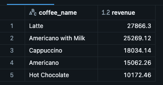
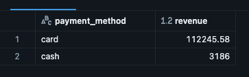
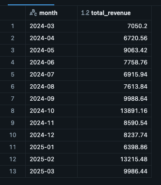
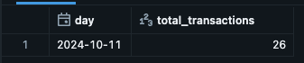
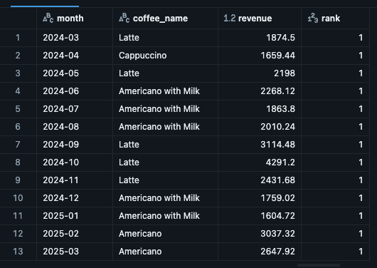

# Databricks SQL Analytics

## Project overview

This project uses Databricks SQL to analyse coffee shop sales data and identify insights into product performance, revenue trends, and payment methods.

The analysis demonstrates SQL skills for querying and aggregating data, analysing sales performance, and presenting business insights through visualisations.

## Dataset

The dataset is stored in the `data/` folder and contains **3,636 rows** of coffee shop transaction data.

| Column | Data type | Description |
|---|---|---|
| `date` | DATE | Transaction date |
| `datetime` | TIMESTAMP | Transaction date and time |
| `cash_type` | STRING | Payment type |
| `card` | STRING | Card identifier, where available |
| `money` | DOUBLE | Transaction amount |
| `coffee_name` | STRING | Coffee product purchased |

## Analysis

The project explores the following business questions:

- Which coffee products generate the highest sales?
- How does revenue vary by payment method?
- How does total revenue change month by month?
- Which days have the highest transaction values?
- Which coffee products perform best in each month?

## Visualisations and insights

### 1. Best selling products

### 2. Revenue by payment method

### 3. Monthly total revenue

### 4. Highest transactions by day

### 5. Monthly best selling product

## Tools and technologies

- **Databricks SQL** for data querying and analysis
- **SQL** for aggregations, filtering, grouping, and sales analysis
- **GitHub** for project documentation and version control

## Key takeaways

This project demonstrates how SQL can be used to transform transactional data into business insights, helping assess product performance, understand revenue patterns, and compare payment methods.
